<p align="center">
  
</p>

<h1 align="center">LanSentinel</h1>

<p align="center">
  <strong>Securización de redes domésticas y pequeñas, con auditorías hechas por IA.</strong><br>
  Vigila cada aparato conectado, detecta amenazas, bloquea lo peligroso y deja que un modelo de IA
  revise tu red y te proponga un plan de mejoras que tú apruebas.
</p>

<p align="center">
  
  
  
  
  
  
</p>

<p align="center">
  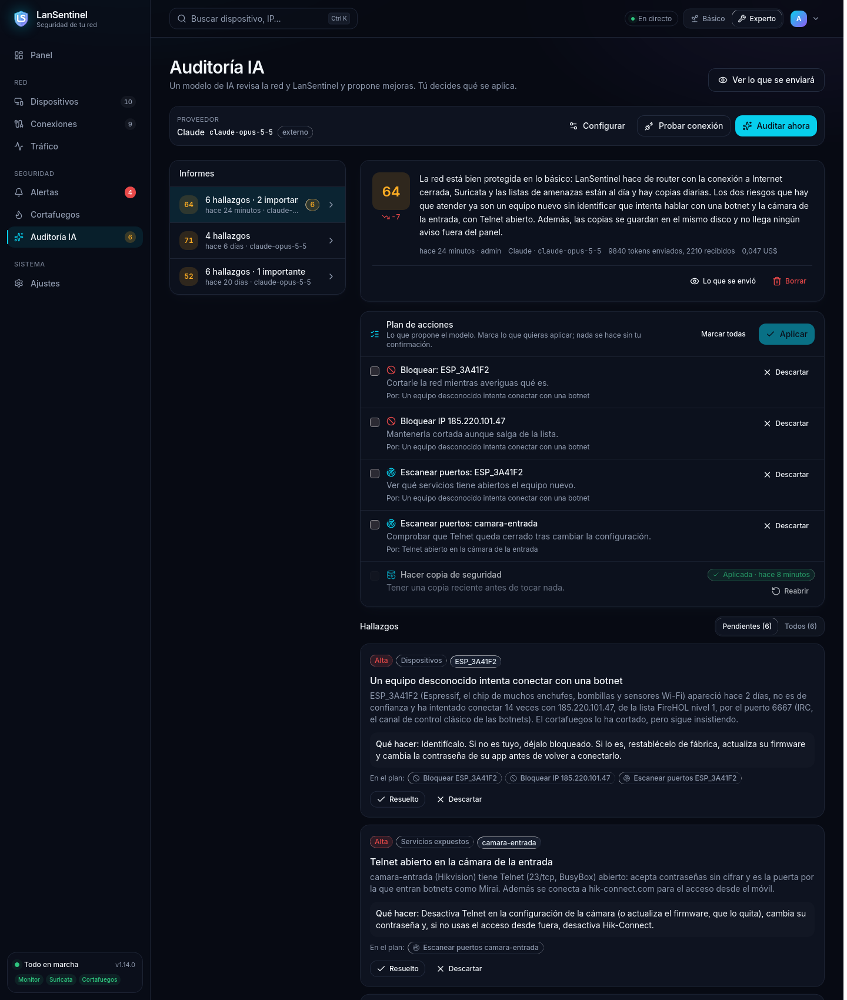
</p>

---

## Índice

- [Qué es LanSentinel](#qué-es-lansentinel)
- [Auditoría con IA](#auditoría-con-ia)
- [Funciones](#funciones)
- [Cómo funciona por dentro](#cómo-funciona-por-dentro)
- [Rendimiento y latencia medidos](#rendimiento-y-latencia-medidos)
- [Requisitos](#requisitos)
- [Instalación paso a paso](#instalación-paso-a-paso)
- [Actualizar, copias y desinstalar](#actualizar-copias-y-desinstalar)
- [Seguridad del propio LanSentinel](#seguridad-del-propio-lansentinel)
- [Privacidad y uso responsable](#privacidad-y-uso-responsable)
- [Limitaciones conocidas](#limitaciones-conocidas)
- [Solución de problemas](#solución-de-problemas)
- [Referencia técnica](#referencia-técnica)
- [Desarrollo](#desarrollo)
- [Historial de versiones y hoja de ruta](#historial-de-versiones-y-hoja-de-ruta)
- [Autor y licencia](#autor-y-licencia)

> Las capturas de este README están hechas con **datos de demostración** (una casa ficticia con diez
> aparatos), no con una red real.

---

## Qué es LanSentinel

En una casa o una oficina pequeña hay cada vez más aparatos conectados (móviles, portátiles,
teles, cámaras, enchufes inteligentes, consolas…) y casi nadie sabe qué hace cada uno. Muchos
llevan software viejo, servicios abiertos o contraseñas por defecto, y el router de la
operadora no avisa de nada.

LanSentinel es un equipo de seguridad para esa red. Se instala en un ordenador pequeño (un mini
PC, un portátil viejo, una máquina virtual) y, desde un panel web, te deja:

1. **Ver** qué hay conectado, con quién habla cada aparato y cuánto consume.
2. **Detectar** lo raro: intrusiones, malware llamando a casa, aparatos nuevos, servicios
   inseguros, suplantación ARP, picos de tráfico.
3. **Actuar**: bloquear un aparato o una IP, poner la red en cuarentena, cortar las IPs de
   listas de amenazas.
4. **Auditar con IA**: un modelo (Claude, OpenAI o uno que corra en tu propia red) revisa una
   foto seudonimizada de la red y del propio LanSentinel, puntúa su seguridad, explica cada
   problema y propone un plan de acciones que se aplica con un clic, siempre con tu confirmación.

Funciona de dos formas:

| Modo | Qué hace | Qué necesita |
|------|----------|--------------|
| **Solo vigilar** (por defecto) | Descubre los aparatos, escanea sus puertos, analiza lo que ve y avisa. No cambia cómo funciona la red. | Un equipo conectado a la red de casa |
| **Router de la red** | Se pone entre el router de la operadora y tus aparatos: todo el tráfico pasa por él, lo ve todo y puede cortar cualquier conexión. Da NAT, DHCP, DNS e IPv6. | Un equipo con dos interfaces de red |

```
Internet ── router de la operadora ── [WAN] LanSentinel [LAN] ── switch / Wi-Fi ── tus aparatos
            (DHCP desactivado o en modo bridge)
```

Para quien no sabe de redes hay un **modo básico** que lo cuenta todo en lenguaje sencillo; el
**modo experto** muestra el panel completo.

---

## Auditoría con IA

La parte central del proyecto. Un IDS y un cortafuegos generan datos; la auditoría con IA los
convierte en un diagnóstico que se entiende y en acciones concretas.

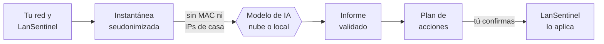

### Qué obtienes

- **Una puntuación de 0 a 100** y un resumen de la situación, con la evolución respecto al
  informe anterior.
- **Hallazgos** ordenados por gravedad, cada uno con qué pasa, a qué aparatos afecta (con su
  nombre real, no el seudónimo) y qué hacer. Se marcan como resueltos o descartados, y los
  pendientes aparecen en la barra lateral.
- **Lo que ya está bien**, para no tocar lo que funciona.
- **Un plan de acciones** dentro de LanSentinel: bloquear o desbloquear un aparato, marcarlo o
  quitarlo de confianza, escanear sus puertos, bloquear o desbloquear una IP de Internet,
  activar o desactivar la cuarentena, actualizar las listas de amenazas, escanear la red o hacer
  una copia. Marcas las que quieras, revisas en una confirmación qué hará cada una y se aplican
  por las mismas rutas que el resto del panel (con sus protecciones y su registro de acciones).
  Lo que no se puede hacer desde el panel (cambiar la contraseña de una cámara, actualizar un
  firmware) va en la recomendación del hallazgo.

### Qué se envía (y qué no)

<p align="center">
  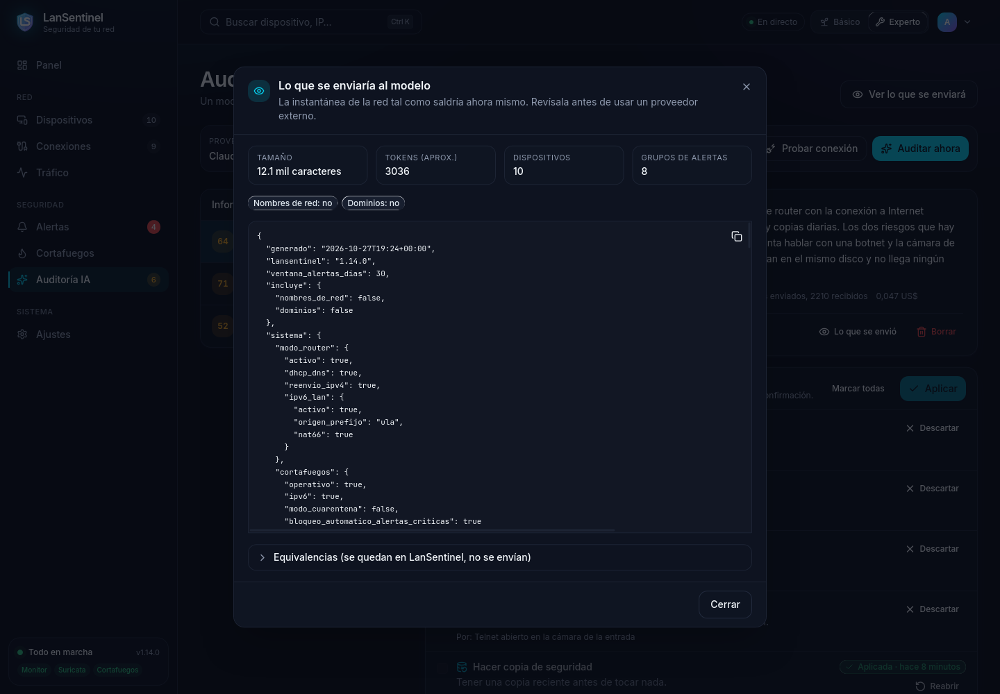
</p>

Antes de configurar ningún proveedor, **Ver lo que se enviará** enseña la instantánea exacta
que saldría hacia el modelo:

- Cada aparato va como `disp-01`, `disp-02`… con su fabricante, si es de confianza, sus puertos
  abiertos (y su riesgo) y cuándo se escanearon, su consumo de la semana y qué parte fue de
  madrugada, un resumen de sus conexiones (cuántas, a qué destinos de Internet, si entra alguien
  de fuera, con qué equipos de casa habla) y sus huellas TLS JA4. **Nada de MAC ni de IPs de la
  red de casa.**
- Las alertas de los últimos 30 días, agrupadas, los bloqueos activos y retirados, y el estado de
  LanSentinel (modo router, IPv6, cortafuegos, reglas, listas de amenazas, HTTPS, copias, avisos,
  usuarios, intentos de entrar al panel y puertos del propio equipo), sin rutas, claves ni
  direcciones.
- En los textos libres (títulos de alertas, motivos de bloqueo) las IPs de casa se cambian por su
  seudónimo, las MAC por `[MAC]` y cualquier otra IP privada por `[IP privada]`.
- Los nombres de red de los aparatos y su historial de dominios **solo salen si los activas**.
- La equivalencia entre seudónimos y aparatos se queda en LanSentinel.

### Proveedores

| Proveedor | Para qué | Los datos |
|-----------|----------|-----------|
| **Claude** (Anthropic) | La mejor calidad de análisis. Unos céntimos por auditoría en una red doméstica. | Salen hacia la API de Anthropic |
| **OpenAI** | Alternativa en la nube | Salen hacia la API de OpenAI |
| **Compatible con OpenAI** (Ollama, LM Studio, llama.cpp, vLLM…) | Un modelo en un equipo de tu red: coste cero | **No salen de casa**: el panel lo marca como *local* |

Con modelos locales pequeños se envía una **instantánea compacta** (la mitad de texto, y sin lo
menos importante si aun así no cabe), se toleran sus despistes típicos (JSON dentro de un bloque de código,
bloques `<think>`, gravedades en inglés…) y lo que no se entienda se marca como fallido.

### Por qué es seguro dejar que una IA opine sobre tu red

- **El modelo no puede cambiar nada.** No tiene herramientas: solo lee la instantánea y devuelve
  un informe. Las acciones las aplicas tú.
- **La instantánea va marcada como datos, no como instrucciones**, para que un nombre de aparato
  o una alerta manipulados no le den órdenes (inyección de instrucciones).
- **LanSentinel valida el informe** contra un esquema y descarta lo que no se sostiene:
  hallazgos sobre aparatos que no existen, acciones sobre IPs que no son de Internet o que no
  aparecen en la instantánea, repetidas o contradictorias (bloquear y marcar de confianza el
  mismo aparato). Lo descartado se puede ver en el informe.
- **Cada informe guarda la instantánea que se envió**, los tokens y el coste estimado.
- **Cambiar el proveedor, su dirección o qué datos se envían pide la contraseña del
  administrador**: con una sesión robada no basta para desviar los datos de la red.
- Solo los administradores ven y usan la auditoría.

### Configurarla

En **Auditoría IA → Configurar** (o en **Ajustes**) se elige el proveedor, el modelo y la clave,
que se guarda cifrada y nunca se vuelve a enseñar. **Probar conexión** comprueba la clave y el
modelo sin gastar tokens y **Auditar ahora** lanza la auditoría en segundo plano (uno o dos
minutos con Claude; varios minutos con un modelo local en CPU). También se puede dejar en `.env`:

```bash
# Claude
AI_AUDIT_PROVIDER=anthropic
AI_AUDIT_API_KEY=sk-ant-...         # o ANTHROPIC_API_KEY
AI_AUDIT_MODEL=claude-opus-5-5      # el modelo por defecto

# OpenAI
AI_AUDIT_PROVIDER=openai
AI_AUDIT_API_KEY=sk-...             # o OPENAI_API_KEY
AI_AUDIT_MODEL=<modelo>             # obligatorio

# Un modelo en casa (aquí, Ollama en otro equipo de la red)
AI_AUDIT_PROVIDER=compatible
AI_AUDIT_BASE_URL=http://192.168.1.50:11434/v1
AI_AUDIT_MODEL=qwen3:8b             # el nombre que da el servidor
```

<details>
<summary><strong>Más ajustes de la auditoría</strong></summary>

| Variable | Por defecto | Qué hace |
|----------|-------------|----------|
| `AI_AUDIT_EFFORT` | `high` | Cuánto razona el modelo (`low` … `max`) en Claude y en los modelos de OpenAI que razonan |
| `AI_AUDIT_COMPACT` | `auto` | Instantánea compacta: automática con servidores compatibles, `true` siempre, `false` nunca |
| `AI_AUDIT_SNAPSHOT_TOKENS` | `3000` | Tamaño máximo de la compacta; la vista previa dice cuánto se ha quedado fuera |
| `AI_AUDIT_TIMEOUT_SECONDS` | `600` | Súbelo con modelos locales lentos |
| `AI_AUDIT_ALERT_DAYS` | `30` | Días de alertas que se envían |
| `AI_AUDIT_INCLUDE_NAMES` / `AI_AUDIT_INCLUDE_DOMAINS` | `false` | Enviar los nombres de red y los dominios de cada aparato |
| `AI_AUDIT_PRICE_INPUT` / `AI_AUDIT_PRICE_OUTPUT` | `0` | Precio por millón de tokens para estimar el coste de modelos que LanSentinel no conoce |

- Con Ollama, el contexto tiene que caber la instantánea, las instrucciones y el informe: al
  menos 8192 tokens (`OLLAMA_CONTEXT_LENGTH=8192`); si no, recorta la entrada sin avisar.
- Un servidor compatible con una dirección de la red de casa (IP privada, `localhost`, un nombre
  `.lan`) cuenta como local; uno de Internet (OpenRouter, por ejemplo), como externo.
- Se pide la respuesta con el esquema del informe; si el servidor no lo admite, JSON libre y, si
  tampoco, texto con el esquema en las instrucciones.

</details>

---

## Funciones

### Ver la red

<p align="center">
  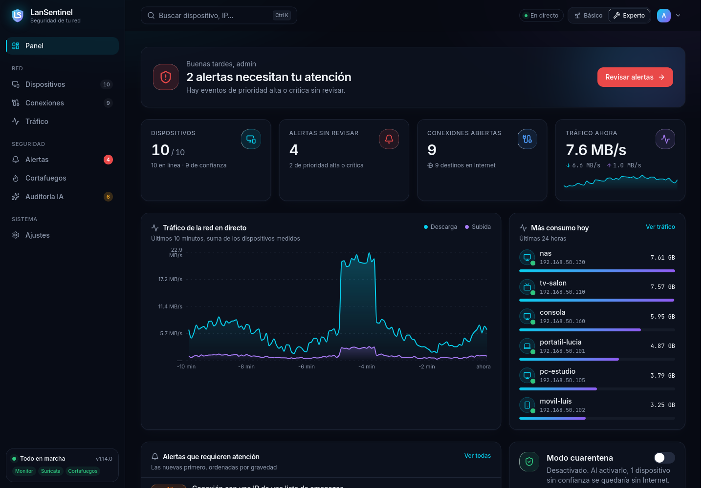
</p>

- **Inventario de aparatos** por ARP: fabricante (lista OUI local del IEEE), nombre, IP, MAC,
  direcciones IPv6, si es de confianza, cuándo apareció. Aviso de **aparatos nuevos** y de
  **cambios de IP**.
- **Ficha de cada aparato** en un panel lateral: resumen, conexiones, consumo, puertos abiertos,
  dominios y huellas TLS.
- **Conexiones en directo** de toda la red (tabla conntrack): abiertas, inactivas, sin respuesta…,
  con el dominio de cada IP remota, los destinos y servicios más frecuentes y bloqueo de una IP
  con un clic.
- **Tráfico** por horas, días o meses y ranking de consumo por aparato; histórico de un año.
- **Dominios y huellas TLS (JA4/JA3)** por aparato, a partir de las consultas DNS y el SNI que
  Suricata ve en claro: qué servicios usa cada equipo y qué programa abre las conexiones.

<table>
  <tr>
    <td>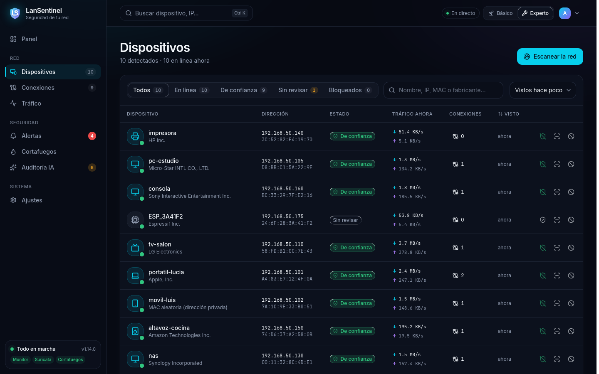</td>
    <td>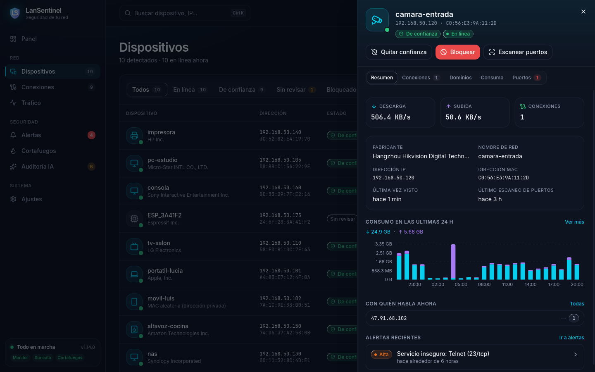</td>
  </tr>
  <tr>
    <td>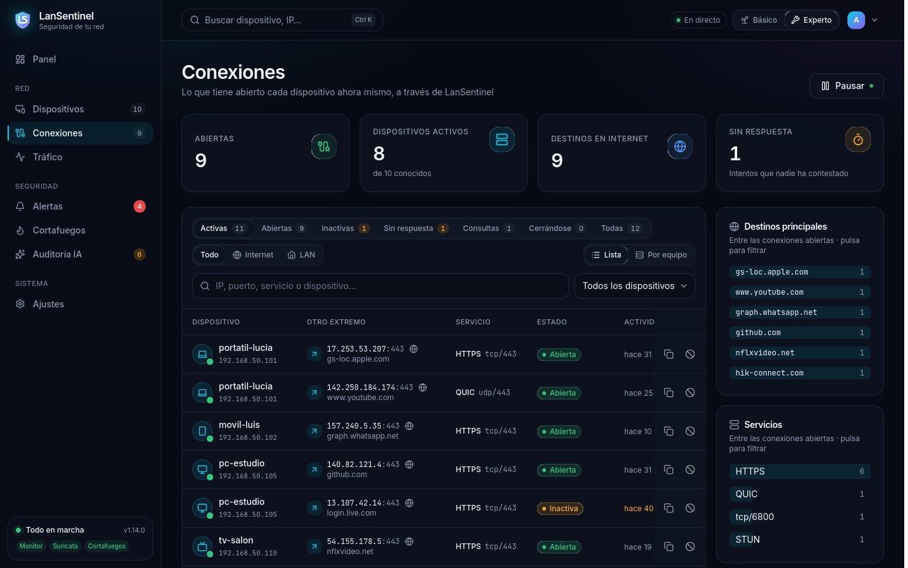</td>
    <td>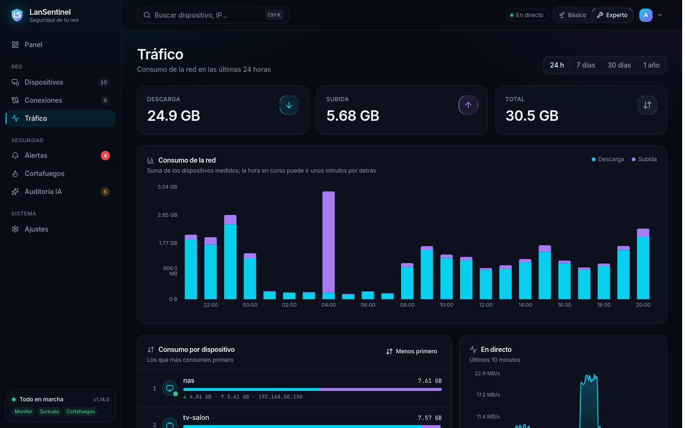</td>
  </tr>
</table>

### Detectar amenazas

- **Suricata** con las reglas de **Emerging Threats (ET Open)**, unas 47.000 firmas de malware,
  exploits, botnets y escaneos, actualizadas cada día, más reglas propias (fuerza bruta,
  escaneos internos).
- **Listas de IPs maliciosas** (FireHOL nivel 1, abuse.ch Feodo Tracker y una lista propia),
  cargadas en el cortafuegos: si un aparato intenta hablar con una, se corta y se avisa.
- **Servicios inseguros**: cada aparato se escanea al aparecer y cada día; aviso de Telnet, FTP,
  VNC, SMB, ADB, Redis, MongoDB… y de puertos que se abren nuevos.
- **Suplantación ARP** (ARP spoofing) contra el propio equipo o la puerta de enlace.
- **Picos de consumo**: cada aparato tiene su patrón; una subida que se dispara (un equipo
  sacando datos o atacando a otros) genera una alerta.
- **Intentos de fuerza bruta** contra el propio panel.

<p align="center">
  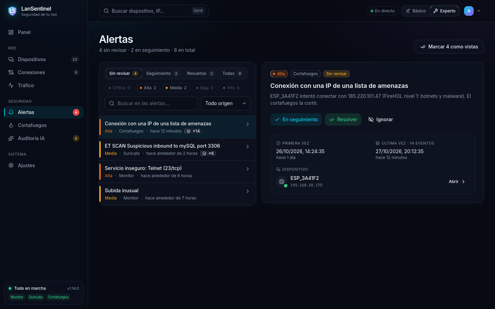
</p>

### Responder

- **Bloqueo por MAC e IP** de un aparato (cambiar de IP no lo esquiva) y bloqueo de IPs de
  Internet.
- **Bloqueo automático** de las IPs externas con alertas críticas. A un aparato de casa solo lo
  corta con las reglas propias: una sola firma (que puede ser un falso positivo) no deja sin red
  a un equipo de casa; para esos casos decides tú.
- **Modo cuarentena**: solo los aparatos de confianza salen a Internet; los demás, también los
  que se conecten por primera vez, quedan retenidos hasta que los apruebes.
- Direcciones protegidas: nunca se bloquea el propio equipo, su puerta de enlace ni las IPs de
  `FIREWALL_NEVER_BLOCK`.

### Ser el router de la red

- **NAT, DHCP y DNS** (dnsmasq) con la **WAN cerrada**: desde Internet solo entran las respuestas
  a lo que piden tus aparatos; el panel, la API y el SSH no quedan expuestos.
- **IPv6** con prefijo delegado por la operadora o, si no delega ninguno, una dirección privada
  con NAT66; el cortafuegos no deja entrar nada desde Internet.
- Se **enciende y apaga desde el panel**, que antes **comprueba que la red está lista**: IP fija
  en la LAN, salida a Internet por la WAN, reenvío del sistema y que no haya otro servidor DHCP
  (dos en la misma red dejarían sin conexión a toda la casa). Lo que falte se explica con cómo
  arreglarlo.
- Rango de IPs, duración, DNS de Internet y dominio local desde el panel; cada aparato responde
  como `nombre.lan`.
- **Control de latencia** (SQM con `cake`): con la conexión llena por una descarga o una copia en
  la nube, los juegos y las videollamadas no van a tirones. Se activa en **Modo router → Latencia**
  con las velocidades de tu conexión (ver [las medidas](#rendimiento-y-latencia-medidos)).

<p align="center">
  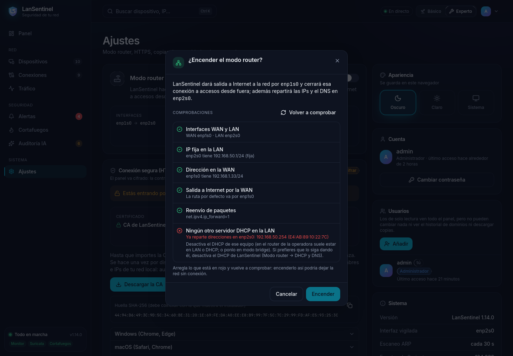
</p>

### Avisar

- **Al instante en el panel** (eventos en directo) y como notificación del navegador.
- **Fuera del panel**: Telegram, ntfy (push al móvil) y correo, con gravedad mínima y límite de
  avisos por hora.

### Para todos los públicos

- **Modo básico**: un resumen que dice en una frase si la red está bien, las alertas contadas en
  lenguaje sencillo con qué hacer ("Un equipo intentó hablar con un sitio peligroso"), los
  aparatos como tarjetas con *Es mío* o *No lo conozco: bloquear*. Esconde IPs, MAC, puertos y
  conexiones.
- **Modo experto**: el panel completo, con buscador global (`Ctrl+K`), tema oscuro o claro y
  vista de móvil.
- **Usuarios con rol** (administrador o solo lectura) y **registro de acciones**: quién cambió
  qué, desde dónde y con qué resultado.
- **Ajustes desde el panel** (IA, avisos, detección, copias, DHCP y DNS, control de latencia), con las claves
  cifradas, sin tocar ficheros ni reiniciar.

<p align="center">
  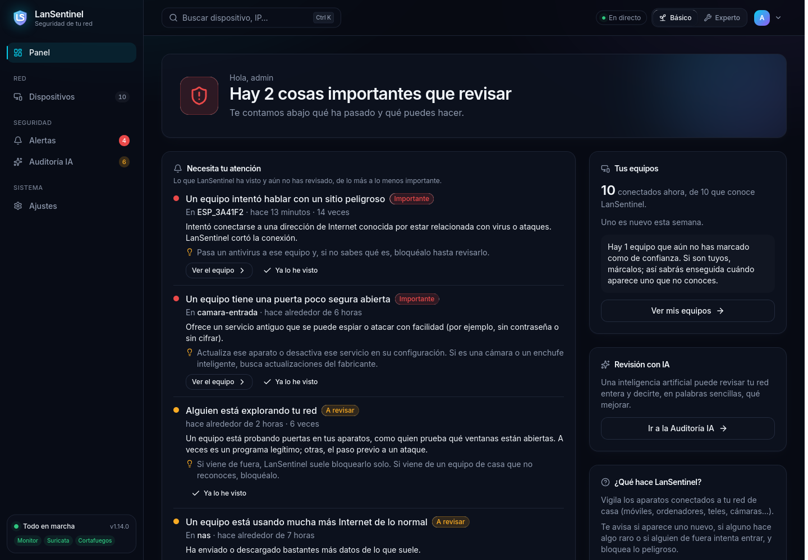
</p>

---

## Cómo funciona por dentro

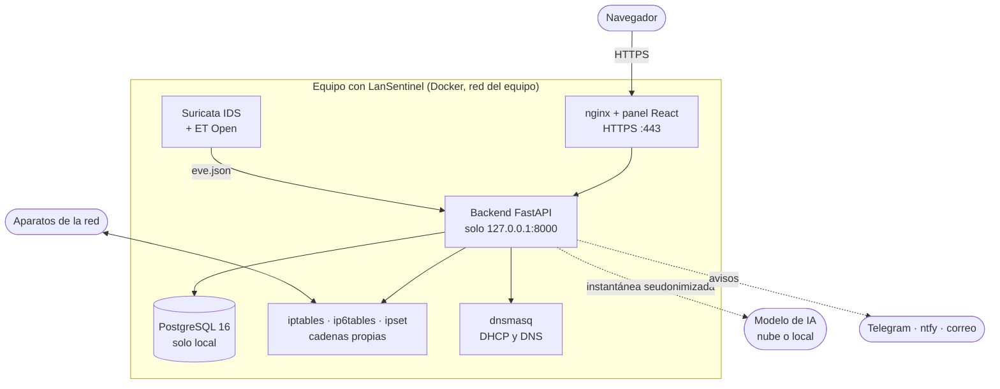

| Capa | Tecnología |
|------|-----------|
| Backend | Python 3.12, FastAPI, SQLAlchemy asíncrono, Scapy, nmap |
| Base de datos | PostgreSQL 16 |
| IDS | Suricata con Emerging Threats Open |
| Cortafuegos | iptables, ip6tables e ipset (Linux) |
| Red | dnsmasq (DHCP, DNS, anuncios IPv6), dhcpcd (prefijo IPv6 delegado), conntrack |
| Frontend | React, TypeScript, Vite, TanStack Query, Tailwind |
| IA | SDK de Anthropic y de OpenAI (y servidores compatibles) |
| Despliegue | Docker Compose; instalador y restauración en Bash |
| Pruebas | pytest; laboratorio con máquinas virtuales VirtualBox |

<details>
<summary><strong>Estructura del proyecto</strong></summary>

```
LanSentinel/
├── backend/
│   ├── app/
│   │   ├── api/routes/       # Endpoints de la API
│   │   ├── core/             # Configuración, seguridad, logs
│   │   ├── db/               # Sesión de SQLAlchemy y migraciones
│   │   ├── models/           # Modelos ORM
│   │   ├── schemas/          # Esquemas Pydantic
│   │   └── services/         # Lógica
│   │       ├── ai_audit/     # Instantánea, proveedores de IA, informes y plan de acciones
│   │       ├── monitor/      # Descubrimiento ARP, fabricantes, tráfico, conexiones
│   │       ├── security/     # Suricata, puertos, ARP spoofing, picos, amenazas
│   │       ├── firewall/     # iptables, modo router, DHCP/DNS, IPv6
│   │       ├── alerts/       # Alertas y avisos
│   │       ├── auth/         # Usuarios, sesiones, registro de acciones
│   │       └── backup/       # Copias de seguridad
│   └── tests/                # pytest
├── frontend/src/             # Panel: páginas, componentes, hooks y tipos
├── docker/                   # Esquema de la BD y configuración de Suricata
├── scripts/                  # instalar.sh, restaurar.sh, tests.sh
├── docs/capturas/            # Capturas de este README
├── docker-compose.yml
└── .env.example
```

</details>

---

## Rendimiento y latencia medidos

Medido en el laboratorio de máquinas virtuales (VirtualBox): LanSentinel en una VM de **1 núcleo y
7 GB** en modo router con Suricata, un equipo de pruebas en la LAN y hasta **200 dispositivos
simulados** (cada uno con su MAC e IP, un servicio web y un puerto que acepta y no contesta, como
muchos aparatos IoT). El "Internet" es un servidor en el anfitrión al otro lado del NAT de la WAN.
Son medidas de laboratorio: en una conexión real se suma la latencia hasta el servidor (de 10 a
40 ms en una partida online típica) y la cola del router de la operadora.

### La red con muchos dispositivos

Petición completa de cada dispositivo a través de LanSentinel (conexión TCP, petición y respuesta)
y ping desde el equipo de pruebas:

| Situación | Peticiones/s | Mediana | 99 % | Ping (media) | Errores |
|-----------|-------------:|--------:|-----:|-------------:|--------:|
| 2 dispositivos | 1 | 4,2 ms | 6,2 ms | 1,4 ms | 0 |
| 200 dispositivos recién llegados (escaneándose) | 98 | 3,4 ms | 7,0 ms | 1,0 ms | 0 |
| 200 dispositivos | 196 | 3,4 ms | 7,8 ms | 0,9 ms | 0 |
| 200 dispositivos + descargas llenando el enlace | 193 | 12,0 ms | 26,3 ms | 3,9 ms | 0 |

Las reglas del cortafuegos por dispositivo y Suricata (que analiza una copia del tráfico) no añaden
latencia apreciable. Con el enlace lleno y un solo núcleo, la latencia sube por la cola: es lo que
resuelve el control de latencia (abajo).

### El panel y la vigilancia con 200 dispositivos

La prueba de carga destapó fallos en la 1.14 que se corrigieron en la 1.15:

| | 1.14 | 1.15 |
|---|---|---|
| 150-198 dispositivos nuevos a la vez | 4 min de errores en el panel (también al entrar) | 0 errores, `/health` p95 31 ms |
| Escaneos de puertos perdidos | 135 de 150 | 0 |
| Tiempo máximo sin buscar dispositivos | 5-9 min | 40 s |
| Búsqueda ARP de 202 dispositivos | 62 s | 7,4 s (2,3 s después) |
| Vista previa de la auditoría IA con 2.200 dispositivos y 20.000 alertas | ~38 min con el backend congelado | 2,4 s, sin parar nada |
| Alertas de Suricata con datos binarios (`\x00`) | se perdían | se guardan |

Con 2.200 dispositivos y 20.000 alertas, el resto de la API responde en 7-60 ms.

### Tráfico de juego y control de latencia

Un juego online manda paquetes UDP pequeños a ritmo constante; lo que estropea la partida es la
latencia cuando otra cosa llena la conexión y, sobre todo, su variación (jitter). Medido con
**64 paquetes UDP por segundo de 100 bytes**, 60 s por caso, sin y con el control de latencia
(`cake`), con descargas y subidas TCP sin parar llenando el enlace:

| Caso | Sin control: mediana / 99 % / jitter | Con `cake`: mediana / 99 % / jitter | Caudal (sin → con) |
|------|--------------------------------------|-------------------------------------|--------------------|
| En reposo | 1,9 / 3,7 / 0,4 ms | 1,8 / 3,7 / 0,4 ms | — |
| Bajada llena | 5,1 / 12,5 / 1,8 ms | **1,3 / 4,6 / 0,7 ms** | 544 → 134 Mbps (límite 150) |
| Subida llena | 7,1 / 23,3 / 2,8 ms | **1,0 / 5,7 / 0,8 ms** | 293 → 111 Mbps (límite 120) |
| Las dos llenas | 12,5 / 29,7 / 3,8 ms | **1,2 / 8,5 / 1,2 ms** | 162/172 → 79/81 Mbps (límite 90/90) |

Sin pérdidas en ningún caso. Con las dos direcciones llenas y límites de 150/120, la mediana bajó a
1,6 ms pero el 99 % se quedó en 14,5 ms: en este equipo de un núcleo, la propia CPU era el cuello
de botella y había que bajar algo más los límites. En casa la regla es la habitual: **un 85-95 % de
lo que da un test de velocidad**, sin nada más en marcha.

**¿Sirve para jugar online?** Sí. En uso normal LanSentinel añade alrededor de 1 ms y unas décimas
de jitter, que no se notan. Si en casa alguien descarga o sube mucho mientras otro juega, conviene
activar el control de latencia: es lo que mantiene la partida estable. Más que la latencia, a
algunos juegos y consolas les afecta el **tipo de NAT** (ver [limitaciones](#limitaciones-conocidas)).

Lo que no se ha medido: hardware y conexiones de operadora reales, ni juegos concretos.

---

## Requisitos

| | Mínimo | Recomendado |
|---|--------|-------------|
| Sistema | Linux con `apt` (Debian o Ubuntu) | Ubuntu Server LTS (probado en Ubuntu 26.04 LTS) |
| Procesador | x86_64, 1 núcleo | 2 núcleos o más |
| Memoria | 2 GB | 4 GB (Suricata con todas las reglas usa unos 500 MB) |
| Disco | 15 GB libres | 30 GB y un disco aparte (USB) para las copias |
| Red | 1 interfaz (solo vigilar) | 2 interfaces (modo router) |

Además: acceso a Internet durante la instalación (imágenes de Docker, reglas de Suricata, listas
de amenazas) y, para la auditoría con IA, una clave de Claude u OpenAI o un servidor de modelos
en la red. La Raspberry Pi no está probada.

---

## Instalación paso a paso

### 1. Descargar LanSentinel

```bash
git clone https://github.com/LuisCorralSieiro/LanSentinel.git
cd LanSentinel
```

### 2. Ejecutar el instalador

```bash
sudo scripts/instalar.sh
```

El instalador:

1. Instala Docker si hace falta.
2. Detecta las interfaces de red y te las confirma (con dos interfaces, cuál va al router de la
   operadora y cuál a tu red).
3. Prepara `.env` con contraseñas aleatorias y sincroniza la hora.
4. Con dos interfaces, deja preparado el modo router (sin encenderlo).
5. Arranca todo (la primera vez tarda unos minutos) y, al terminar, enseña **la dirección del
   panel, la contraseña inicial y la huella del certificado**.

Se puede volver a ejecutar en cualquier momento: no pierde datos ni cambia el modo que ya tenga.

| Opción | Para qué |
|--------|----------|
| `--si` | No preguntar: acepta lo detectado |
| `--wan IFACE` / `--lan IFACE` | Elegir las interfaces |
| `--router` | Dejarlo ya como router de la red (comprueba la IP fija de la LAN y si hay otro DHCP) |
| `--sin-router` | Apagar el modo router de una instalación anterior |
| `--sin-dhcp` | En modo router, sin DHCP ni DNS (ya los da otro equipo) |
| `--ipv6` | Dar también IPv6 a la red |

### 3. Entrar en el panel

1. Abre `https://<ip-del-equipo>` (o `https://lansentinel.lan` si LanSentinel ya da el DNS).
2. El navegador avisará de que no conoce el certificado: LanSentinel usa **su propia autoridad
   (CA)**. Acepta el aviso esta vez; para quitarlo, descarga la CA en **Ajustes → Conexión
   segura** e impórtala en tus dispositivos (hay instrucciones para cada sistema). Comprueba
   antes que su huella coincide con la que enseñó el instalador.
3. Entra con el usuario `admin` y la contraseña inicial. El panel te pedirá **elegir una tuya**
   antes de seguir.

### 4. Primeros pasos en el panel

1. **Dispositivos**: marca como de confianza los aparatos que reconozcas. Así sabrás enseguida
   cuándo aparece uno que no conoces.
2. **Ajustes → Avisos externos**: configura Telegram, ntfy o correo para enterarte sin abrir el
   panel.
3. **Auditoría IA**: mira *Ver lo que se enviará*, configura el proveedor y lanza la primera
   auditoría.
4. Si quieres que LanSentinel sea el router, sigue el paso 5.

### 5. Convertirlo en el router de la red (opcional)

Necesitas un equipo con dos interfaces de red.

1. Pon una **IP fija en la interfaz LAN**, por ejemplo con netplan en
   `/etc/netplan/60-lansentinel.yaml`:

   ```yaml
   network:
     version: 2
     ethernets:
       enp2s0:                       # tu interfaz LAN
         dhcp4: false
         addresses: [192.168.50.1/24]
   ```

   y aplícala con `sudo netplan try` (se deshace sola si pierdes la conexión).
2. Conecta la **WAN** al router de la operadora y la **LAN** a tu switch o punto de acceso Wi-Fi
   (en modo AP, sin router ni DHCP).
3. Desactiva el **DHCP del router de la operadora** (o ponlo en modo bridge).
4. En **Ajustes → Modo router**, enciéndelo. El panel comprueba antes que todo está listo y, si
   falta algo, te dice cómo arreglarlo.
5. Reconecta tus aparatos (o espera a que renueven su IP).

Para volver atrás, apágalo desde el mismo sitio y vuelve a activar el DHCP del router de la
operadora.

---

## Actualizar, copias y desinstalar

### Actualizar

```bash
cd LanSentinel
git pull
sudo scripts/instalar.sh
```

El instalador hace una copia de seguridad antes de actualizar, conserva `.env`, la base de datos y
el modo, y aplica los cambios del esquema sin borrar datos.

### Copias de seguridad

Cada copia (`lansentinel-<fecha>-<hora>-<motivo>.tar.gz`) lleva la base de datos completa, el
estado de `/var/lib/lansentinel` (clave de sesión, CA, certificado, DHCP) y el `.env`.

- Una al día a las 3:00, la primera al poco de instalar, antes de cada actualización y cuando
  pulsas **Ajustes → Copias de seguridad → Hacer copia ahora**.
- Se guardan las 7 más recientes y una por semana durante 4 semanas.
- En `/var/lib/lansentinel/backups`, o en la carpeta de `BACKUP_PATH` (mejor un disco aparte).
  Desde el panel se pueden descargar para guardarlas fuera.
- Alerta si una copia falla o si la última correcta tiene más de dos días.
- Contienen secretos (contraseñas cifradas, la clave de la CA, `.env`): solo root puede leerlas.

Para restaurar:

```bash
sudo scripts/restaurar.sh lansentinel-20261026-030000-diaria.tar.gz
```

Antes hace una copia del estado actual, restaura la base de datos en una sola transacción (si
falla, queda como estaba) y vuelve a arrancarlo. **En un equipo nuevo**: clona el repositorio,
ejecuta el instalador, copia el fichero de la copia y restáurala; la CA que importaste en tus
dispositivos sigue valiendo.

### Desinstalar

1. Si LanSentinel es el router, apágalo en **Ajustes → Modo router** y vuelve a activar el DHCP
   del router de la operadora.
2. Descarga una copia desde el panel si quieres conservar los datos.
3. Para y borra los contenedores y los datos:

   ```bash
   cd LanSentinel
   sudo docker compose --profile production down -v    # -v borra también la base de datos
   sudo rm -rf /var/lib/lansentinel                     # CA, certificado, copias y estado
   sudo rm -f /etc/sysctl.d/90-lansentinel.conf         # reenvío del modo router
   ```

---

## Seguridad del propio LanSentinel

Un equipo de seguridad no puede ser el punto débil de la red:

- **Panel solo por HTTPS** (HTTP/2), con CA propia con **restricción de nombres**: solo puede
  firmar nombres de la red local e IPs privadas, así que aunque alguien robara su clave no le
  serviría para suplantar webs de Internet.
- **La API y la base de datos no escuchan en la red**: solo en `127.0.0.1`, detrás de nginx.
- **Sesión** en cookie `httpOnly`, `SameSite=Strict` y `Secure`; contraseñas con Argon2;
  **límite de intentos** con alerta de fuerza bruta.
- **Contraseña inicial aleatoria** que el panel obliga a cambiar.
- **Roles**: los usuarios de solo lectura no pueden cambiar nada (lo aplica el backend, no solo
  el panel), ni ver el historial de dominios, ni descargar copias.
- **Registro de acciones** de todo cambio, con los secretos tapados; no se puede borrar desde el
  panel.
- **Secretos cifrados** en la base de datos y nunca devueltos por la API. Cambiar un secreto o un
  destino de los datos pide la contraseña del administrador.
- **Sin socket de Docker en el backend** (equivaldría a control total del equipo) y contenedores
  con solo las capacidades de red que necesitan.
- **En modo router, la WAN está cerrada**: nada de LanSentinel ni de la red de casa se publica en
  Internet.

---

## Privacidad y uso responsable

- **Usa LanSentinel solo en redes que sean tuyas o que administres con permiso.** Analizar el
  tráfico o escanear equipos de redes ajenas puede ser ilegal.
- LanSentinel ve **qué dominios visita cada aparato** (es el historial de navegación de quien lo
  usa). Si la red la usan otras personas, infórmales. Ese historial solo lo ve el administrador,
  se borra a los 30 días sin verse y se puede desactivar (`DOMAIN_TRACKING_ENABLED=false`).
- Todo se guarda **en el propio equipo**. Lo único que sale es lo que configures: los avisos
  (Telegram, ntfy, correo) y la auditoría con IA si usas un proveedor en la nube; con un modelo
  local, nada sale de casa.
- La búsqueda de fabricantes desconocidos en Internet (`OUI_ONLINE_LOOKUP`) está desactivada por
  defecto.

---

## Limitaciones conocidas

- **En modo solo vigilar**, LanSentinel solo ve el tráfico que pasa por él: descubre los aparatos y
  sus puertos, pero las conexiones, el consumo, los dominios y las listas de amenazas necesitan
  que sea el router.
- **Suricata funciona como IDS**, no como IPS: detecta y LanSentinel corta después con el
  cortafuegos; no descarta paquetes en línea.
- El tráfico **directo entre aparatos de la LAN** no pasa por LanSentinel (va por el switch o el
  Wi-Fi), salvo lo que ve Suricata en la interfaz.
- Lo que va por **DNS cifrado (DoH/DoT) o ECH** no se ve: de eso solo queda el servidor.
- Las **listas de IPs maliciosas son solo IPv4**.
- **Sin reenvío de puertos ni UPnP** en modo router: la WAN está cerrada a todo lo que llega de
  fuera. Las consolas y los juegos que conectan jugadores entre sí (P2P) pueden indicar NAT
  "moderado" o "estricto" (emparejamiento más lento, chat de voz, no poder alojar partidas); los
  de servidores dedicados no se ven afectados. Si el router de la operadora no está en modo
  bridge, además hay doble NAT.
- Con **un solo núcleo y la conexión llena** (cerca de 1 Gbps con Suricata), el panel va lento
  mientras dura; la red no. Para redes grandes o conexiones rápidas, mejor 2 núcleos o más.
- **Probado en laboratorio** (máquinas virtuales); falta la prueba de una instalación nueva desde
  cero en un equipo limpio.
- La Raspberry Pi no está probada.

---

## Solución de problemas

<details>
<summary><strong>El navegador dice que la conexión no es segura</strong></summary>

Es normal la primera vez: el certificado lo firma la CA de LanSentinel, que tu navegador aún no
conoce. Descarga la CA en **Ajustes → Conexión segura**, comprueba su huella con la que enseñó el
instalador e impórtala.
</details>

<details>
<summary><strong>No encuentro la contraseña inicial</strong></summary>

La enseña el instalador al terminar. Mientras no la cambies, también está en
`/var/lib/lansentinel/initial_admin_password` (solo legible por root):

```bash
sudo cat /var/lib/lansentinel/initial_admin_password
```
</details>

<details>
<summary><strong>He olvidado la contraseña</strong></summary>

Otro administrador puede ponerte una nueva en **Ajustes → Usuarios**. Si eras el único, todavía no
hay un procedimiento para restablecerla desde el equipo (está en la hoja de ruta).
</details>

<details>
<summary><strong>El modo router no se deja encender</strong></summary>

El diálogo dice qué comprobación falla y cómo arreglarla. Lo más habitual: falta la IP fija en la
LAN o el router de la operadora sigue dando DHCP en la misma red.
</details>

<details>
<summary><strong>La auditoría con un modelo local falla o tarda mucho</strong></summary>

Sube `AI_AUDIT_TIMEOUT_SECONDS`, comprueba que el contexto del modelo es de al menos 8192 tokens
(`OLLAMA_CONTEXT_LENGTH=8192` en Ollama) y usa **Probar conexión** para ver si el servidor y el
modelo responden.
</details>

<details>
<summary><strong>Ver qué está pasando por dentro</strong></summary>

```bash
sudo docker compose --profile production ps          # estado de los contenedores
sudo docker logs --tail 100 lansentinel_backend      # registros del backend
sudo docker logs --tail 100 lansentinel_suricata     # registros de Suricata
```
</details>

---

## Referencia técnica

<details>
<summary><strong>Modo router: detalles</strong></summary>

En modo router (`ROUTER_MODE=true`), LanSentinel enruta con NAT entre `WAN_INTERFACE` y
`MONITOR_INTERFACE` y cierra la WAN: desde Internet solo entran las respuestas a conexiones
salientes. dnsmasq (que el backend arranca y para) reparte las IPs y resuelve los nombres de la
red. El estado elegido en el panel se guarda; si `ROUTER_MODE` cambia en `.env` (por ejemplo al
volver a ejecutar el instalador), manda en el siguiente arranque.

Antes de encenderlo desde el panel se comprueba: interfaces, IP fija en la LAN, dirección en la
WAN (en otra red que la LAN), ruta por defecto por la WAN, `net.ipv4.ip_forward` y, si LanSentinel
va a dar DHCP, que no haya otro servidor DHCP en la LAN (pide una dirección y espera hasta 6
segundos a ver quién responde, sin aceptar ninguna). Lo mismo al volver a activar el DHCP con el
modo encendido. El rango de IPs se comprueba contra la red de la LAN y dnsmasq se relanza al
guardar.
</details>

<details>
<summary><strong>IPv6</strong></summary>

Con `--ipv6` (o `IPV6_LAN=true`), en modo router LanSentinel da también IPv6 a la LAN. El prefijo
sale, por este orden, de:

1. `IPV6_PREFIX`: un prefijo fijo que la operadora enruta hacia este equipo.
2. Un **prefijo delegado (DHCPv6-PD)** que se pide a la operadora por la WAN (`IPV6_PD`): lo
   habitual en fibra.
3. Si la operadora no delega ninguno, una **dirección privada (ULA) con NAT66**
   (`IPV6_NAT_FALLBACK`). En cuanto llega un prefijo delegado, se pasa a él.

Los aparatos se configuran solos (anuncios de router y DNS por DHCPv6 sin estado). En IPv6 tienen
direcciones públicas, así que el cortafuegos no deja entrar nada desde Internet salvo las
respuestas. Bloqueos por MAC, cuarentena, conteo de tráfico, conexiones y dominios funcionan
también en IPv6: las direcciones de cada equipo (también las de privacidad, que cambian cada día)
se sacan de la tabla de vecinos. Con un prefijo delegado público, añádelo a `HOME_NET` en
`docker/suricata/suricata.yaml`.
</details>

<details>
<summary><strong>HTTPS y acceso a la API</strong></summary>

El panel se sirve por HTTPS en el 443 (`PANEL_HTTPS_PORT`); HTTP (80 y 3000) solo redirige. La CA
de LanSentinel se crea en `/var/lib/lansentinel/tls` y dura 10 años; el certificado del panel se
renueva solo al cambiar la IP o un mes antes de caducar. Para usar un certificado propio,
sustituye `server.crt` (con la cadena) y `server.key` en esa carpeta: el backend no toca un
certificado que no haya firmado él. Sin HSTS a propósito: con un certificado que el navegador aún
no conoce, impediría aceptar el aviso.

La API está en `https://<ip>/api/v1/...` y su documentación interactiva en `https://<ip>/docs`
(botón *Authorize* con tu usuario). Para scripts, pide un token en `/api/v1/auth/token` y úsalo
como `Authorization: Bearer`.
</details>

<details>
<summary><strong>Usuarios, sesiones y registro de acciones</strong></summary>

| Rol | Puede |
|-----|-------|
| Administrador | Todo |
| Solo lectura | Ver todo el panel. No puede cambiar nada, ni ver el historial de dominios, ni descargar copias, ni ver usuarios o el registro. Sí puede cambiar su propia contraseña |

- Un cambio de rol vale al momento. Desactivar o borrar a alguien, o ponerle una contraseña
  nueva, cierra sus sesiones. Siempre queda al menos un administrador activo.
- Sesión de 12 horas (`ACCESS_TOKEN_EXPIRE_MINUTES`). 5 intentos fallidos desde una IP bloquean
  el login de ese usuario desde esa IP 5 minutos y generan una alerta.
- Si `SECRET_KEY` está vacía (o es corta o de ejemplo) se genera una en
  `/var/lib/lansentinel/secret_key`.
- El registro de acciones guarda quién, desde qué IP, qué y con qué resultado (también los
  intentos denegados y los inicios de sesión fallidos) durante `AUDIT_LOG_DAYS` días (365).
</details>

<details>
<summary><strong>Detección: detalles</strong></summary>

- **Suricata**: las reglas se descargan con `suricata-update` y se recargan cada día
  (`RULES_UPDATE_HOURS`) sin reiniciarlo; si una actualización trae reglas que fallan, sigue con
  las anteriores. No se cargan `emerging-info`, `emerging-hunting` ni las de protocolos
  industriales (`docker/suricata/disable.conf`). En `eve.json` solo escribe alertas, DNS y TLS,
  rotado al pasar de `SURICATA_LOG_MAX_MB`.
- **Listas de amenazas**: se descargan cada día (`THREAT_LISTS_UPDATE_HOURS`) y se cargan en un
  ipset de forma atómica. Cualquier red que se solape con rangos privados, el propio equipo, su
  puerta de enlace o `FIREWALL_NEVER_BLOCK` se descarta. Lista propia en
  `/var/lib/lansentinel/amenazas/propia.txt`.
- **ARP spoofing**: alerta crítica si otro equipo reclama la IP de LanSentinel o cambia la MAC de
  la puerta de enlace; alta si una IP alterna entre dos MAC. Solo alerta.
- **Puertos**: escaneo al descubrir cada aparato y cada `PORT_SCAN_INTERVAL_HOURS` (24 h).
- **Picos de consumo**: al acabar cada hora se compara con las horas de actividad de las dos
  últimas semanas (5 veces lo habitual, 6 desviaciones y al menos 100 MB de subida); hacen falta
  48 horas de actividad antes de juzgar un aparato. Variables `ANOMALY_*`.
</details>

<details>
<summary><strong>Cortafuegos: cadenas</strong></summary>

| Cadena | Enlazada desde | Contenido |
|--------|----------------|-----------|
| `LANSENTINEL_THREAT` | `FORWARD` e `INPUT` (las primeras) | Listas de IPs maliciosas (ipset `lansentinel-amenazas`) |
| `LANSENTINEL` | `INPUT` | Bloqueos del tráfico hacia el propio equipo |
| `LANSENTINEL_FWD` | `FORWARD` | Bloqueos del tráfico reenviado |
| `LANSENTINEL_QUAR` | `FORWARD` | Modo cuarentena |
| `LANSENTINEL_ACCT` | `FORWARD` | Conteo de tráfico por aparato |
| `LANSENTINEL_ROUTE` | `FORWARD` | Modo router: LAN → WAN y respuestas |
| `LANSENTINEL_WAN_IN` | `INPUT` | Modo router: desde la WAN solo respuestas, ICMP y DHCP |
| `LANSENTINEL_NAT` | `POSTROUTING` (nat) | Modo router: NAT de lo que sale por la WAN |

Las cadenas se vacían y se reconstruyen desde la base de datos al arrancar: no hay reglas
guardadas a mano.
</details>

<details>
<summary><strong>Conexiones, dominios e histórico de tráfico</strong></summary>

- **Conexiones** (tabla conntrack): *Abierta* (TCP con tráfico reciente o UDP sostenido),
  *Inactiva* (TCP sin tráfico 30 min), *Sin respuesta*, *Consulta* (DNS, NTP, ping) y
  *Cerrándose*. Debajo de cada IP remota, el dominio visto por DNS o SNI en las últimas 6 horas.
- **Dominios y huellas TLS**: se guardan agregados (un registro por aparato y dominio), se borran
  a los `DOMAIN_HISTORY_DAYS` días (30) sin verse.
- **Histórico**: `network_usage` (cada minuto, 7 días) y `network_usage_hourly` (por horas, 365
  días), agrupados en la zona horaria `TIMEZONE`.
</details>

<details>
<summary><strong>Ajustes: panel o .env</strong></summary>

Lo del día a día se cambia en **Ajustes** sin tocar `.env` ni reiniciar: proveedor de IA, avisos,
detección, copias, zona horaria, registro de acciones y DHCP y DNS del modo router. Cada ajuste
dice de dónde sale su valor (panel, `.env` o por defecto) y se puede devolver al de `.env`. En
`.env` queda lo que se fija al instalar: interfaces, IPv6, base de datos, `SECRET_KEY`, rutas,
`FIREWALL_NEVER_BLOCK` y las URLs de las listas. Todas las variables están explicadas en
[`.env.example`](.env.example).
</details>

---

## Desarrollo

```bash
cp .env.example .env
docker compose -f docker-compose.yml -f docker-compose.dev.yml up    # BD + backend + panel con recarga
```

- API en `http://localhost:8000/docs`, panel en `http://localhost:3000` (en desarrollo, sin HTTPS).
- En producción, con Suricata: `docker compose --profile production up -d`.
- El esquema inicial está en `docker/db/init.sql`; los cambios posteriores se aplican al arrancar
  con sentencias idempotentes (`backend/app/db/migrations.py`), sin borrar datos.

### Tests

```bash
scripts/tests.sh            # todos
scripts/tests.sh -k copias  # los argumentos van a pytest
```

Se ejecutan dentro de la imagen del backend; solo hace falta Docker. Cubren la lógica que más se
puede romper sin que se note: lectura de conntrack e iptables, reglas del modo router y sus
comprobaciones, direcciones protegidas, dnsmasq, lectura de eve.json, ARP spoofing, servicios
inseguros, contraseñas y sesiones, la CA del panel, copias, histórico, la instantánea de la
auditoría con IA y la validación de sus informes. Lo que depende de iptables, la base de datos o la
red se prueba en un laboratorio de máquinas virtuales.

---

## Historial de versiones y hoja de ruta

LanSentinel nació como Trabajo de Fin de Grado (versión 1.0) y ha seguido creciendo como proyecto
personal.

| Versión | Novedades |
|---------|-----------|
| 1.0 | Monitorización ARP, Suricata, escaneo de puertos, cortafuegos, alertas y panel |
| 1.1 | Cadenas propias en iptables, bloqueo por MAC e IP, IPv6, agrupación de alertas |
| 1.2 | Seguridad del propio sistema: autenticación, base de datos solo local, sin socket de Docker |
| 1.3 | Histórico de tráfico por aparato |
| 1.4 | Alertas en tiempo real y avisos por Telegram, ntfy y correo |
| 1.5 | ARP spoofing, servicios inseguros y modo cuarentena |
| 1.6 | Conexiones por aparato y de toda la red; rediseño completo del panel |
| 1.7 | Instalador y modo router (NAT, WAN cerrada, DHCP y DNS); panel por HTTPS con CA propia |
| 1.8 | Copias de seguridad automáticas y restauración |
| 1.9 | Tests; reglas de Emerging Threats y listas de IPs maliciosas |
| 1.10 | Picos de consumo; dominios y huellas TLS por aparato |
| 1.11 | Usuarios con rol y registro de acciones; IPv6 en la LAN |
| 1.12 | **Auditoría con IA** (Claude, OpenAI o modelo local) con plan de acciones |
| 1.13 | Ajustes desde el panel, modo básico, solo vigilar por defecto |
| 1.14 | Primer arranque sin terminal: comprobaciones del modo router, contraseña inicial en el instalador, DHCP y DNS desde el panel |
| 1.15 | Rendimiento con redes grandes (probado con 200 dispositivos simulados): la auditoría con IA ya no congela el backend, los escaneos de puertos no agotan la base de datos, alertas con caracteres binarios que antes se perdían, descubrimiento más rápido |

**Siguiente:**

- [ ] Prueba de una instalación nueva desde cero en un equipo limpio (con una y con dos
  interfaces), cronometrada, corrigiendo cada paso que sobre.
- [ ] Restablecer la contraseña del único administrador desde el equipo.
- [ ] Reenvío de puertos o UPnP opcional (con aviso: abre la red) para las consolas y los juegos
  P2P.

---

## Autor y licencia

Desarrollado por **Luis Corral Sieiro**.

El repositorio todavía no tiene licencia: mientras no se publique una, todos los derechos están
reservados por el autor.
